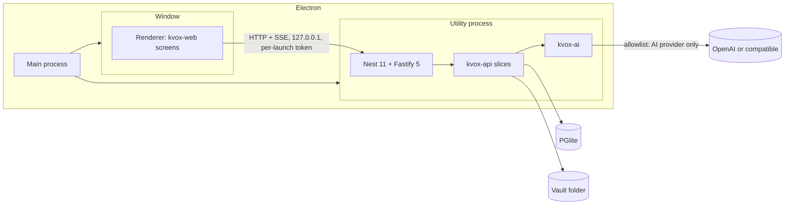

# KVox Desktop

Single-user, offline-first desktop application for meeting notes and a personal knowledge graph.

## What it is

- Inputs: PDF transcripts, KVox transcript export JSON, Markdown or text, and KVox note exports. There is no transcription ([ADR-0006](https://github.com/marinoscar/kvox/blob/main/docs/decisions/0006-desktop-inputs-no-transcription.md)).
- Outputs: AI notes, a connected-knowledge graph, search, and Ask.
- AI: OpenAI or an OpenAI-compatible base URL. GitHub Copilot is an extension ([ADR-0005](https://github.com/marinoscar/kvox/blob/main/docs/decisions/0005-ai-architecture-shared-harness.md)).
- Data stays on the device. The AI provider is the only cloud egress ([ADR-0004](https://github.com/marinoscar/kvox/blob/main/docs/decisions/0004-desktop-data-local-only.md)).

## Core principle

**This repository contains no domain logic.** All domain behaviour lives in the published `@marinoscar/kvox-*` packages ([ADR-0001](https://github.com/marinoscar/kvox/blob/main/docs/decisions/0001-packages-first.md)).

| Belongs here | Belongs in the packages |
|---|---|
| Port bindings (the ten ports of `@marinoscar/kvox-api/ports`, `KvoxWebHost`) | Transcripts, notes, search, graph, Ask |
| The shell: navigation, settings hub, theme | Prompts, pipelines, structured-output rules, the tool loop, budgets |
| Packaging and updates | Schemas, parsers, importers |
| Host glue: settings namespaces, onboarding | Task-to-model choice, error mapping (`@marinoscar/kvox-ai`, #579) |

If Desktop needs different behaviour, add an option or a port to the package. Do not fork.

## Architecture



## Tech stack

| Concern | Choice | Source |
|---|---|---|
| Shell | Electron 44.9.0 (pinned exactly; bundles Node 24.22.0) | [ADR-0002](https://github.com/marinoscar/kvox/blob/main/docs/decisions/0002-desktop-shell-electron.md) |
| Build | electron-vite | ADR-0002 |
| Server | Nest 11, Fastify 5, in a `utilityProcess` | ADR-0002 |
| Renderer | React 19, MUI 9, React Router 7 | ADR-0002 |
| Database | PGlite (Postgres in WebAssembly) with vector, pg_trgm, uuid-ossp | [ADR-0003](https://github.com/marinoscar/kvox/blob/main/docs/decisions/0003-graph-store-postgresql-everywhere.md) |
| Packaging | electron-builder, electron-updater | ADR-0002 |
| Tests | Vitest, Playwright for Electron | ADR-0002 |

## Data and privacy

Data folder (`app.getPath('userData')`):

| OS | Folder |
|---|---|
| Windows | `%APPDATA%\KVox` |
| macOS | `~/Library/Application Support/KVox` |
| Linux | `~/.config/KVox` |

Documents, transcripts, notes, the graph and settings live there; documents are copied into a local vault. Nothing is uploaded. What leaves the device:

- Text sent to the configured AI provider when you generate a note or extract the graph. A `sensitive` PersonFact never leaves.
- A request to GitHub Releases, only if you enable update checks (default off).

No telemetry, no crash upload. The loopback server requires a per-launch token. For fully offline use, point the OpenAI-compatible base URL at a local model server (Ollama, LM Studio).

## AI providers

| Provider | Setup | Status |
|---|---|---|
| OpenAI | Paste the API key in settings; it is stored in the OS keychain | First release |
| OpenAI-compatible | Set the base URL (and key if needed) | First release |
| GitHub Copilot | One more provider adapter (#581) | Later, if its requirements can be met |

## Repository layout

```
src/main/        Electron main process: window, kvox:// scheme, egress guard, server lifecycle
src/preload/     Preload bridge (kvoxDesktop.connection(): port + per-launch token)
src/renderer/    React app: KvoxWebHost over loopback, kvox-web notes screens
src/server/      Utility process: Nest 11 + Fastify 5 on 127.0.0.1, PGlite
  ports/         Port bindings (copied from kvox examples/bare-host, plus the launch-token identity)
src/shared/      Main <-> server message types
scripts/         prepare-db.mjs (schema, migrations, client), vendor-kvox-packages.mjs
vendor/kvox/     The four @marinoscar/kvox-* tarballs (temporary, see below)
tests/unit/      Vitest
tests/e2e/       Playwright for Electron (the D1 smoke test)
```

## Getting started

Prerequisites: Node 24 or later, npm 11 or later.

```bash
npm ci
npm run dev        # prepare the database layer, then run the app with hot reload
npm run typecheck
npm test           # unit tests (Vitest)
npm run build      # prepare:db + electron-vite build (out/)
npm run e2e        # Playwright for Electron against out/ (Linux: xvfb-run -a npm run e2e)
npm run dist       # build + unsigned installers in release/
```

`KVOX_E2E_EXECUTABLE=<path to the packaged app>` makes `npm run e2e` drive an installed or unpacked app instead of `out/` (CI does this).

### How a launch works

1. The main process mints a random per-launch token and forks the server utility process (`out/main/server.js`).
2. The server opens PGlite in-process under `<userData>/db` with `vector`, `pg_trgm` and `uuid_ossp`, creates `vector` and `pg_trgm`, serves it on a loopback socket (one connection), runs `prisma migrate deploy` and, when that applied anything, `kvox-db check --database`. Both run as child processes on the Electron binary (`ELECTRON_RUN_AS_NODE`), with Prisma's update check off.
3. It seeds the one local user, adopts the default organization, seeds the note templates and starts Nest on `127.0.0.1:0`. Every route needs `Authorization: Bearer <token>`.
4. The window loads `kvox://app`, asks the preload for the port and token, and mounts the kvox-web notes screens over a `KvoxWebHost` that talks HTTP + SSE to the loopback server.

The window's session cancels (and logs) any request that is not loopback, `kvox:`, `file:`, `data:`, `blob:` or `devtools:`.

## Package versions

Pin the `@marinoscar/kvox-*` packages to exact versions and bump them together; they are one release group. `@marinoscar/platform-db` is pinned to `0.1.0-next.5`, the version `@marinoscar/kvox-db` was tested with.

**Temporary: the kvox packages are vendored.** Until marinoscar/kvox#577 publishes them to npm, `vendor/kvox/` holds the four tarballs, built from marinoscar/kvox and packed with `npm pack` (as `examples/bare-host/run.mjs --from pack` does). `vendor/kvox/SOURCE.json` records the kvox commit and each tarball's SHA-256; `package.json` depends on them through `file:` paths. To refresh:

```bash
npm run vendor:kvox                       # clones marinoscar/kvox main, builds, packs
npm run vendor:kvox -- --kvox ../kvox     # or from an existing checkout
npm install                               # then commit vendor/kvox/ and package-lock.json together
```

When the packages are on npm, replace the `file:` specs with exact versions and delete `vendor/` and the script.

## Database migrations

`npm run prepare:db` (run by `dev` and `build`) writes `prisma/` (git-ignored): `platform db sync`, `platform db compose`, `kvox-db sync --names after-host`, compose again, `prisma generate`. The platform installer gets a fixed `--timestamp`, so the same package versions always produce the same migration directory names. Open point for D2: an upgrade that adds a platform migration shifts the `after-host` names of the domain migrations, which an existing user database has already recorded; this needs a decision in the packages before the first release that ships to users.

## Roadmap

| Issue | Step | Scope |
|---|---|---|
| #577 | D0 | Publish the packages |
| #582 | D1 | Stack spike |
| #583 | D2 | Ports and local data |
| #584 | D3 | AI wiring |
| #585 | D4 | Imports |
| #586 | D5 | Graph and Ask |
| #587 | D6 | Packaging |

Package-side work in the kvox repository: #570 (PR #575), #571, #572, #573, #578, #579, #580, #581.

Version 1 acceptance bar: the app answers both reference questions from imported meetings.

1. "What are the action items from Joe?"
2. "What meetings have we had with Jenny's boss?"

## More

- [KVox Desktop guide](https://github.com/marinoscar/kvox/blob/main/docs/guides/kvox-desktop.md)
- [Host ports spec](https://github.com/marinoscar/kvox/blob/main/docs/specs/kvox-ports.md)
- [Packages](https://github.com/marinoscar/kvox/blob/main/docs/PACKAGES.md)
- [Architecture decisions](https://github.com/marinoscar/kvox/blob/main/docs/decisions/README.md)
