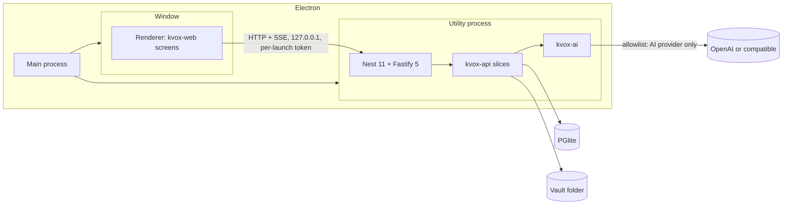

# KVox Desktop

Single-user, offline-first desktop application for meeting notes and a personal knowledge graph.

## What it is

- Inputs: PDF transcripts, KVox transcript export JSON, Markdown or text, and KVox note exports. There is no transcription ([ADR-0006](https://github.com/marinoscar/kvox/blob/main/docs/decisions/0006-desktop-inputs-no-transcription.md)).
- Outputs: AI notes, a connected-knowledge graph, search, and Ask.
- AI: OpenAI or an OpenAI-compatible base URL. GitHub Copilot is an extension ([ADR-0005](https://github.com/marinoscar/kvox/blob/main/docs/decisions/0005-ai-architecture-shared-harness.md)).
- Data stays on the device. The AI provider is the only cloud egress ([ADR-0004](https://github.com/marinoscar/kvox/blob/main/docs/decisions/0004-desktop-data-local-only.md)).

## Core principle

**This repository contains no domain logic.** All domain behaviour lives in the published `@marinoscar/kvox-*` packages ([ADR-0001](https://github.com/marinoscar/kvox/blob/main/docs/decisions/0001-packages-first.md)).

| Belongs here | Belongs in the packages |
|---|---|
| Port bindings (the ten ports of `@marinoscar/kvox-api/ports`, `KvoxWebHost`), the data folder and its backup | Transcripts, notes, search, graph, Ask |
| The shell: navigation, settings hub, theme | Prompts, pipelines, structured-output rules, the tool loop, budgets |
| Packaging and updates | Schemas, parsers, importers |
| Host glue: settings namespaces, onboarding | Task-to-model choice, error mapping (`@marinoscar/kvox-ai`, #579) |

If Desktop needs different behaviour, add an option or a port to the package. Do not fork.

## Architecture



## Tech stack

| Concern | Choice | Source |
|---|---|---|
| Shell | Electron 44.9.0 (pinned exactly; bundles Node 24.22.0) | [ADR-0002](https://github.com/marinoscar/kvox/blob/main/docs/decisions/0002-desktop-shell-electron.md) |
| Build | electron-vite | ADR-0002 |
| Server | Nest 11, Fastify 5, in a `utilityProcess` | ADR-0002 |
| Renderer | React 19, MUI 9, React Router 7 | ADR-0002 |
| Database | PGlite (Postgres in WebAssembly) with vector, pg_trgm, uuid-ossp | [ADR-0003](https://github.com/marinoscar/kvox/blob/main/docs/decisions/0003-graph-store-postgresql-everywhere.md) |
| Packaging | electron-builder, electron-updater | ADR-0002 |
| Tests | Vitest, Playwright for Electron | ADR-0002 |

## Data and privacy

Data folder (`app.getPath('userData')`):

| OS | Folder |
|---|---|
| Windows | `%APPDATA%\KVox` |
| macOS | `~/Library/Application Support/KVox` |
| Linux | `~/.config/KVox` |

Everything KVox keeps lives there, and nowhere else ([ADR-0004](https://github.com/marinoscar/kvox/blob/main/docs/decisions/0004-desktop-data-local-only.md)):

| Path | Holds |
|---|---|
| `db/` | PGlite's data directory: notes, transcripts, the graph, jobs and the app settings (`system_settings`, `user_settings`) |
| `vault/<key>` | The bytes of every document and stored object, one file per object. Files appear whole (written elsewhere, then renamed) |
| `logs/audit.log` | Append-only JSON lines: who, what, which id, counts. Never titles, text or file names |
| `secrets.bin` | Saved API keys, each an Electron `safeStorage` blob (OS keychain, DPAPI or Secret Service) |
| `settings.json` | The shell's own preferences: the plaintext-keys consent below, and "Check for updates" (off unless you turn it on) |
| `tmp/` | Scratch files and upload parts; emptied at every start |
| `copilot/` | Only if you turn on GitHub Copilot: its private state (`home/`: sessions and sign-in material, `work/`: an empty working directory) and the downloaded runtime (`runtime/<version>/`). Never in a backup (see [Network and privacy: GitHub Copilot](#network-and-privacy-github-copilot)) |

Saved keys never rest in the clear. On Linux without a keyring, Electron falls back to its `basic_text` backend; KVox then refuses to save a key (HTTP 409, `secret_storage_plaintext`) and Settings > Data and privacy shows a warning. Keys are saved only after you set up a keyring or explicitly accept plaintext storage there.

What leaves the device:

- Text sent to the configured AI provider when you generate a note or extract the graph. A `sensitive` PersonFact never leaves.
- Requests to GitHub Releases, only if you turn on Settings > Updates > "Check for updates" (default off). Until then the updater is not loaded and its session cancels every request; once on, it may reach `github.com`, `api.github.com`, `objects.githubusercontent.com` and `release-assets.githubusercontent.com` over HTTPS, and nothing else (see [Updates](#updates)).

No telemetry, no crash upload, no remote fonts. Both processes enforce it:

- **Window**: the page's CSP allows only loopback (`connect-src http://127.0.0.1:*`), and the session cancels any request that is not loopback, `kvox:`, `file:`, `data:`, `blob:` or `devtools:`.
- **Server**: a global undici dispatcher (for `fetch`) and a guard on every outgoing socket (`http`, `https`, `tls`, `net`) allow loopback and the configured AI provider's host only: `api.openai.com` for OpenAI, the base URL's host for an OpenAI-compatible server (none at all for one on this device). Saving the AI settings replaces the allowlist at once.

Every blocked request is an error line in the log with the host only (`window: egress blocked: example.com`, `server: egress blocked: example.com`), plus a running count. The loopback server requires a per-launch token. For fully offline use, point the OpenAI-compatible base URL at a local model server (Ollama, LM Studio).

### Network and privacy: GitHub Copilot

GitHub Copilot is opt-in and off by default. While it is off there is no runtime process, no proxy listener and no Copilot traffic, and nothing is downloaded. What turning it on adds (marinoscar/kvox-desktop#23):

- **A download, once.** The Copilot SDK drives a separate runtime of 130 to 175 MB per platform. The installer does not contain it: the first opt-in downloads it from GitHub's release hosts only (`github.com`, `objects.githubusercontent.com`, `release-assets.githubusercontent.com`, every redirect hop checked), refuses it unless its SHA-256 matches, and keeps it in `copilot/runtime/<version>`. An optional installer flavour bundles it instead (see [Packaging](#the-copilot-runtime)).
- **A child process that cannot reach the internet by itself.** The runtime is a separate process, so the guard above cannot see its sockets. It is started with `HTTPS_PROXY` and `HTTP_PROXY` pointing at a proxy that KVox runs on `127.0.0.1` (a random port, protected by random credentials so no other program can use it) and an empty `NO_PROXY`. The proxy opens HTTPS tunnels to these hosts and refuses everything else (plain HTTP, other ports, IP addresses, sub-domains), logging each refusal with the host only. The server's own guard applies a second time to the tunnel:

  | Host | For |
  |---|---|
  | `api.githubcopilot.com` | Model traffic: chat completions and the model listing |
  | `github.com` | Sign-in |
  | `api.github.com` | Account and entitlement calls, the Copilot token exchange |

  The list is `COPILOT_EGRESS_HOSTS` of `@marinoscar/kvox-ai/copilot`. It was read from the runtime, not captured on the wire, so a refusal in the log (`copilot egress refused: CONNECT to <host>:443`) is how a missing host would show. The runtime does honour `HTTPS_PROXY` (checked against SDK 1.0.22, runtime 1.0.98: it sent `CONNECT api.github.com:443` with the proxy's credentials to a listener given as `HTTPS_PROXY`).
- **Telemetry, honestly.** KVox never turns the SDK's OpenTelemetry on and sets the conventional off switches in the runtime's environment (`COPILOT_OTEL_ENABLED=false`, `OTEL_SDK_DISABLED=true`, `DO_NOT_TRACK=1`) and removes any OTLP endpoint and the tokens in `GH_TOKEN`, `GITHUB_TOKEN` and `COPILOT_GITHUB_TOKEN` from its environment. The runtime itself contains a GitHub product-telemetry service with **no documented off switch**, so KVox cannot promise that GitHub receives no usage data from a signed-in runtime. What it guarantees is where that traffic can go: only the three hosts above, because the proxy refuses the rest. Do not read "no telemetry" as covering Copilot.
- **Sign-in scopes.** The runtime runs the sign-in itself; no token reaches KVox. Its authorization asks for broad GitHub scopes (`read:user read:org repo gist ...`) and the consent screen lists them.
- **Stored where.** Everything the runtime keeps is in `copilot/`, which is excluded from **Export data** and never touched by **Restore**: a backup never carries sign-in material, and a restored profile signs in again. Runtime output is never written to the log unredacted (the log level is `none`, and every line the sandbox writes goes through the package's token redaction).
- **Turning it off.** The runtime is stopped, the proxy closed and the environment put back; quitting the app does the same, and a runtime that does not stop is killed. "Remove Copilot data" deletes `copilot/` except the downloaded runtime, or including it if you choose.

### Export data and Restore

Settings > Data and privacy > **Export data…** writes one `.kvoxbackup` file wherever you choose. It is a zip of:

- `db.tar.gz`: a PGlite dump taken after a checkpoint.
- `vault/`: every document.
- `manifest.json`: the app version, the database's migrations, and each file's size and SHA-256.

**Restore…** checks a backup and replaces everything with it:

- Every file is checked against the manifest.
- Entries that would land outside the data folder are refused.
- A backup from a newer app version is refused.
- The app then restarts its server, which swaps the data in before the database opens. Any failure puts the previous data back.

Both run as background jobs. The `copilot/` folder, saved API keys, `settings.json` and the logs are not in a backup: the keys only decrypt for this OS user on this machine, so enter them again after a restore.

## Importing

Notes > **Import…** opens the system file dialog; dropping files anywhere on the window does the same. KVox reads each file in the main process and sends it to the local server (never anywhere else):

| You import | KVox creates | Then |
|---|---|---|
| A PDF transcript, a Markdown or a text file | A note source document; its text is extracted | "New note" opens with the document chosen: pick a template and generate |
| A transcript exported from KVox web as JSON (`kvox.transcript/v1`) | A transcript, with its speaker names and recording date | "New note" opens with the transcript chosen |
| A note exported from KVox web as Markdown | The same note (same title and body), ready to edit | The note opens |

The file's content decides, not its name (`detectKvoxImport` in `@marinoscar/kvox-contract/notes`); the formats are read by the packages, never here. A file KVox cannot use (audio, video, a foreign JSON) gets the server's own explanation. Size limits are the slices': 5 MiB for a note, 25 MiB for a transcript, `ai.maxDocumentBytes` (10 MiB) for a document. There is no transcription: audio and video are refused.

## Knowledge graph and asking questions

The graph, graph-extraction, graph-rdf and Ask slices of `@marinoscar/kvox-api` run in the local server (`src/server/app.module.ts`). Their screens come from `@marinoscar/kvox-web/graph` and `/ask` (`src/renderer/src/routes.tsx`). Desktop adds no graph logic; it only wires them.

| Bar item | Screen | What you do there |
|---|---|---|
| **Knowledge** | The graph index, an entity page, the explorer, the overview | Browse people, organizations and meetings; on a person, **Set manager**, **Set employer** or **Add role**, and remove a wrong one |
| **Review** | The proposals waiting for review | Open a note's proposal, accept or reject rows, **Send to graph** |
| **Ask** | Conversations | Ask a question; the answer cites the meetings and facts it used |

How facts get in:

1. A note becomes ready (generated, or imported) and the graph extracts it (`kg.extract`). This is on by default, and it uses your AI provider like note generation does.
2. Named speakers in an imported transcript become people automatically (`kg.speaker_link`), each with an `ATTENDED` link to the meeting.
3. You review the proposal. Nothing enters the graph until you send it.
4. Anything a meeting never said, you can set by hand on the person's page. Each manual edit is stored with its own evidence ("Set by hand"), and Ask cites it that way.

Ask answers from the graph through the packages' tools (`search`, `list_commitments`, `neighbors`, `timeline`, …). It never writes SQL. It needs a model with tool calling: OpenAI or an OpenAI-compatible server. GitHub Copilot is planned without Ask. The reference questions, answered by the e2e test (`tests/e2e/graph-ask.spec.ts`) on synthetic meetings:

| Question | How it is answered |
|---|---|
| What are the action items from Joe? | `search(Joe)` → `list_commitments(Joe, owned_by, open)`, citing the meeting where he committed |
| What meetings have we had with Jenny's boss? | `search(Jenny)` → `neighbors(Jenny, REPORTS_TO)` → `timeline(boss, meeting)`, citing the reporting line and the meetings |

Host duties Desktop carries for the graph:

- The system `ai` namespace declares `graphEnabled`, **on** by default here, and `reasoningEffort`. Settings > **Connected knowledge** switches it (`GET`/`PATCH /api/desktop/knowledge`). Off, KVox makes no graph or Ask call to the AI provider (the graph's AI routes answer 409 `graph_disabled`), hides Knowledge, Review and Ask, and keeps the graph you already have. The window mirrors the switch in `KvoxWebHost.features()`.
- An hourly housekeeping timer (`src/server/housekeeping.ts`) calls the four enqueuers, because every slice runs with `schedules: false`.
- The RDF peers (`n3`, `jsonld`, `rdf-validate-shacl`) and the `graphology` layout peers are installed.
- The SHACL validation of a graph import runs in a utility process (`src/main/shacl-validate.ts`, wired through `shacl.run`). The RunAsNode fuse is off, so the package's default of spawning the binary as Node cannot work.

## Settings

**Settings** is the platform's registry-driven hub (`SettingsHub` of `@marinoscar/platform-web/settings/ui`), the same component KVox web uses for `/settings`: a grid of cards, or a list below 600 px wide, each opening its own page with a way back. Desktop adds only the registry, `src/renderer/src/settings/sections.tsx` (`DESKTOP_SETTINGS_SECTIONS`), and one route per card, `settings/routes.tsx`.

| Card | Route | Page |
|---|---|---|
| AI provider | `/settings/ai` | The provider, model and server URL, then the platform's key card ([AI providers](#ai-providers)) |
| Connected knowledge | `/settings/knowledge` | The `ai.graphEnabled` switch |
| Note Templates | `/settings/note-templates` | The notes slice's templates page (it left the top bar for the hub, as on web) |
| Data and privacy | `/settings/data` | The data folder, Export data and Restore, how saved keys are protected |
| Updates | `/settings/updates` | The opt-in "Check for updates" |

Restore and "Store keys without system encryption" ask for a typed confirmation (the platform's `TypedConfirmDialog`: tick the box and type `RESTORE`, or `PLAINTEXT KEYS`). A new page is a card in the registry and a route, appended at the end; `tests/unit/settings-hub.test.tsx` fails when one has no counterpart.

## Look and feel

KVox Desktop looks like KVox web because it uses the same code for it, and defines none of it. The theme is `createKvoxTheme('light' | 'dark')` of `@marinoscar/kvox-web/brand` (the indigo and amber palette, dark `#0f1117` ground and `#171a23` cards with a 1px divider border, sentence-case buttons), applied by the platform's `ShellRoot` (`@marinoscar/platform-web/shell/ui`, wrapped by `DesktopThemeRoot` in `src/renderer/src/theme.tsx`). The Inter font is `@marinoscar/kvox-web/brand/fonts/inter.css`, imported in `main.tsx`: electron-vite emits the woff2 into the app bundle, so no request is made and the CSP (`font-src 'self' data:`) is unchanged (ADR-0004). The app icons come from the package's `mark.svg` too (Packaging, below).

- **Light, dark or system.** The choice is `ShellRoot`'s (`useShellTheme`, default `system`). A temporary button in the app bar sets it, until the shared shell (#18) brings its own toggle, and so does **View > Toggle light/dark** of the application menu.
- **It survives a restart.** `ShellRoot` keeps it in `localStorage` (`theme_mode`, stable because the page is always `kvox://app`). The main process needs it before any page exists, so the page also reports it and main keeps a copy as `themeMode` in `<userData>/settings.json`; that copy is the fallback when `localStorage` comes back empty.
- **No white flash.** The `BrowserWindow` is created with `backgroundColor` set to the page ground of the saved mode (`kvoxTokens` of the brand package; `system` asks `nativeTheme`), and `nativeTheme.themeSource` follows the choice, so scroll bars and native menus match.
- **Rule.** Nothing brand-related is defined in this repository: a colour, a font stack or a logo that is missing belongs in `@marinoscar/kvox-web/brand`. `tests/unit/theme.test.ts` fails on a `createTheme(` call or a colour literal in `src/renderer` or `src/main`; `tests/e2e/smoke.spec.ts` checks the computed colours, Inter, the persisted mode and the window colour in the packaged app, and attaches light and dark screenshots to the report.

## AI providers

Settings > AI provider. `KVOX_AI` is the packages' own `createKvoxAi` over `createDirectRuntime` (`@marinoscar/kvox-ai`), with the OpenAI adapters of the lean `@marinoscar/platform-ai-providers` (marinoscar/kvox#578) and the key read from `KVOX_SECRETS` on every call (`src/server/ai/`).

| Provider | Setup | Status |
|---|---|---|
| OpenAI | Pick the model, paste the API key and **Save & verify**; it is stored in the OS keychain. **Test** and **Re-check** ask OpenAI whether the key works; **Remove** forgets it | Available |
| OpenAI-compatible | Set the base URL, model and wire style (Chat Completions or Responses), and a key (same card) unless the server takes none (then the page says "No key needed") | Available |
| GitHub Copilot | A disabled, opt-in slot: decided "go, without Ask" (marinoscar/kvox#581); its models will report no tool calling. The runtime download, its egress proxy and its data folder are in place (marinoscar/kvox-desktop#23); the settings and adapter loading are marinoscar/kvox-desktop#21 | Adapter not wired yet |

The key block is the platform's `UserAiKeyCard` (`KeylessProviderCard` for a keyless server), the card KVox web shows. **Save & verify** and **Test** run on the local server, never in the window: `POST /api/desktop/ai/keys/:provider/test` calls the adapter's `verifyKey` (and `listModels` for the count) with the typed key, or the stored one when none is typed, and answers a verdict in the platform's `AiProbeResult` shape (HTTP 200; `success` is the answer). The key goes to the provider and nowhere else: not into the answer, an error or a log line. A key the provider rejects is not stored; a host the egress guard refuses (a provider other than the one saved in Settings) is a readable failed check, not a socket error.

The non-secret choices are the system settings namespace `desktopAi` (in the database, so they travel in a backup); keys are `KVOX_SECRETS` purpose `ai`, named after the provider, and never appear in a setting, a response, a log line or an error. Semantic search embeds with OpenAI's `text-embedding-3-small` (the packages' embedding catalog), so it needs an OpenAI key and the OpenAI provider; otherwise search stays full-text.

## Repository layout

```
src/main/        Electron main process: window, kvox:// scheme, window egress guard, server lifecycle,
                 safeStorage and Notification for the server, backup dialogs, import (dialog, dropped files),
                 migration utility processes (node-scripts.ts), opt-in updates (updates.ts, update-policy.ts)
src/preload/     Preload bridge (kvoxDesktop: connection, data folder, backup dialogs, secret storage, import, updates, theme mode)
src/renderer/    React app: KvoxWebHost over loopback, kvox-web notes, graph and Ask screens (routes.tsx),
                 the settings hub, its registry and one page per card (settings/), the Import action and drop target (import/)
src/server/      Utility process: Nest 11 + Fastify 5 on 127.0.0.1, PGlite, server egress guard,
                 the housekeeping timer (housekeeping.ts), the SHACL runner (shacl-runner.ts)
  ports/         One adapter per port (below)
  backup/        .kvoxbackup export and restore, run as jobs
src/shared/      Main <-> server message types
scripts/         prepare-db.mjs (schema, migrations, client), build-icons.mjs (the icons, `npm run icons`),
                 dist.mjs (installers, signed when the secrets exist), packaged-app.mjs (asar and fuse
                 checks, the e2e copy), release-files.mjs (latest-mac.yml merge, SHA256SUMS, publish gate)
build/           Packaging resources: macOS entitlements, the NSIS "Remove my data" step, the AppArmor profile, the generated icons (`npm run icons`)
.github/         ci.yml (every PR: four runners, unsigned installers, e2e on the packaged app), release.yml (v* tags)
tests/unit/      Vitest: the ports conformance kit, jobs (timeouts, back-off, a real kill mid-job), egress, secrets, backup
tests/crash/     The child process the crash-recovery test kills
tests/unit/import.test.ts  every import kind against the real local server
tests/e2e/       Playwright for Electron (smoke, window egress and settings, import by dialog and drag and drop, opt-in updates,
                 the graph and the Ask reference questions)
tests/support/   The OpenAI-compatible loopback mock and its scripted model (the package's scenario model)
tests/fixtures/  Synthetic fixtures: import (a PDF transcript, a transcript JSON, a note export) and graph (three meetings)
```

### Ports

| Port | Adapter (`src/server/ports/`) | Rules |
|---|---|---|
| `KVOX_OBJECT_STORE` | `local-fs-object-store.ts`: `vault/<key>`, rows in `storage_objects` | Atomic writes; `managedBy` in `storage_objects.metadata`; keys with `..`, absolute paths, backslashes or drive prefixes refused; delete removes file and row |
| `KVOX_JOBS` | `pg-table-jobs.ts`: in-process runner over `jobs` | One job at a time; `maxRuntimeMs` enforced (abort signal); exponential back-off; `running` rows recovered at start-up; `KvoxRateLimitError` defers without spending an attempt; dedup via `jobs_active_dedup_uniq_idx` |
| `KVOX_IDENTITY` | `launch-token-identity.ts` | The seeded local user; per-launch bearer token |
| `KVOX_SETTINGS` | `pg-settings.ts`: `system_settings`, `user_settings` | The host declares the system `ai` namespace; `defaults: undefined` reads as `undefined` |
| `KVOX_SECRETS` | `safe-storage-secrets.ts`: `secrets.bin` | `safeStorage` via the main process; refuses `basic_text` without consent |
| `KVOX_NOTIFY` | `desktop-notify.ts`: Electron `Notification` via the main process | Heading and a fixed line; no note content |
| `KVOX_EVENTS` | `KvoxEventEmitterEvents` (package default) | |
| `KVOX_AUDIT` | `jsonl-audit.ts`: `logs/audit.log` | Append-only; ids and counts only |
| `KVOX_PRISMA` | The PGlite-backed client (`database.ts`) | Pool of one |
| `KVOX_BRAND` | `KVox Desktop` | |
| `KVOX_AI` | `ai/desktop-ai.ts`: `createKvoxAi` over `createDirectRuntime` | Keys from `KVOX_SECRETS` per call; models from the `desktopAi` settings (#584) |

`tests/unit/ports-conformance.test.ts` runs `describeKvoxPortsConformance` against these adapters (all but `ai`); `tests/unit/desktop-ai.test.ts` runs `describeKvoxAiConformance` against the `ai` binding.

## Getting started

Prerequisites: Node 24 or later, npm 11 or later.

```bash
npm ci
npm run dev        # prepare the database layer, then run the app with hot reload
npm run typecheck
npm test           # unit tests (Vitest)
npm run build      # prepare:db + electron-vite build (out/)
npm run e2e        # Playwright for Electron against out/ (Linux: xvfb-run -a npm run e2e)
npm run dist       # build + installers in release/ (unsigned unless the signing variables are set)
```

`KVOX_E2E_EXECUTABLE=<path to the packaged app>` makes `npm run e2e` drive an installed or unpacked app instead of `out/` (CI does this). The packaged binary refuses `--inspect`, which Playwright needs, so drive a copy: `node scripts/packaged-app.mjs test-copy` prints one (see [Packaging](#packaging)).

### How a launch works

1. The main process mints a random per-launch token and forks the server utility process (`out/main/server.js`).
2. The server installs its egress guard, applies a staged restore if there is one, then opens PGlite in-process under `<userData>/db` with `vector`, `pg_trgm` and `uuid_ossp`, creates `vector` and `pg_trgm`, serves it on a loopback socket (one connection), runs `prisma migrate deploy` and, when that applied anything, `kvox-db check --database`. Both run as utility processes the main process forks on the server's behalf (`src/main/node-scripts.ts`; the RunAsNode fuse is off, so the binary cannot be spawned as Node), with Prisma's update check and telemetry off.
3. It seeds the one local user, adopts the default organization, seeds the note templates and starts Nest on `127.0.0.1:0`. Every route needs `Authorization: Bearer <token>`. Then it recovers the jobs a previous run left `running` (requeued, or failed when out of attempts) and starts the job loop.
4. The window loads `kvox://app`, asks the preload for the port and token, and mounts the kvox-web notes screens over a `KvoxWebHost` that talks HTTP + SSE to the loopback server.


## Install

Download from the [latest release](https://github.com/marinoscar/kvox-desktop/releases). Every release carries `SHA256SUMS` (and `SHA256SUMS.asc` when it is GPG-signed).

| OS | File | Notes |
|---|---|---|
| Windows 10/11 (x64, arm64) | `KVox-<version>-win-setup.exe` | Installs for the current user only; no administrator prompt. One installer for both architectures |
| Windows 10/11 (x64) | `KVox-<version>-win-x64.msi` | The same app as an MSI, for `msiexec /i`, winget or group policy. Installs for the current user. An MSI has no "Remove my data" step: uninstalling always leaves your data folder |
| macOS 13+ (Apple silicon) | `KVox-<version>-mac-arm64.dmg` | **Not built for now**: releases carry no macOS files until the Mac legs are switched back on in `ci.yml` and `release.yml`. Open the dmg, drag KVox to Applications |
| macOS 13+ (Intel) | `KVox-<version>-mac-x64.dmg` | Not built for now (see above) |
| Ubuntu 22.04+ / Debian (x64) | `KVox-<version>-linux-amd64.deb` | **Recommended on Linux**: `sudo apt install ./KVox-<version>-linux-amd64.deb` |
| Linux (x64) | `KVox-<version>-linux-x86_64.AppImage` | `chmod +x` and run. Needs `libfuse2` (`sudo apt install libfuse2t64` on 24.04, `libfuse2` on 22.04) |

Verify a download before running it:

```bash
sha256sum -c SHA256SUMS --ignore-missing          # Linux; macOS: shasum -a 256 -c SHA256SUMS --ignore-missing
gpg --verify SHA256SUMS.asc SHA256SUMS            # when the release has a signature
```

On Windows: `Get-FileHash .\KVox-<version>-win-setup.exe -Algorithm SHA256` (or the `.msi`) and compare with the line in `SHA256SUMS`.

**Ubuntu 24.04 and AppArmor.** Ubuntu 24.04 restricts unprivileged user namespaces, which the Chromium sandbox needs. The `.deb` installs an AppArmor profile (`/etc/apparmor.d/kvox-desktop`, from `build/linux/kvox-desktop.apparmor`) that grants them to `/opt/KVox/kvox-desktop` only, and loads it; on 22.04 the profile is skipped (no AppArmor ABI 4.0) and not needed. The AppImage cannot install a profile: on 24.04 prefer the `.deb`, or add an equivalent profile for the AppImage's path yourself. Never run KVox with `--no-sandbox`.

### Uninstall

Uninstalling removes the app, never your data unless you ask for it:

- **Windows**: Settings > Apps > KVox > Uninstall. The uninstaller asks "Remove my data?"; the default, No, keeps `%APPDATA%\KVox`. An update never asks and never removes it.
- **macOS**: drag `/Applications/KVox.app` to the Bin. To remove your data too: `rm -rf ~/Library/Application\ Support/KVox`.
- **Ubuntu / Debian**: `sudo apt remove kvox-desktop`. To remove your data too: `rm -rf ~/.config/KVox`.
- **AppImage**: delete the file; data as on Ubuntu.

Export your data first (Settings > Data and privacy > Export data) if you may want it back.

## Updates

Off by default ([ADR-0004](https://github.com/marinoscar/kvox/blob/main/docs/decisions/0004-desktop-data-local-only.md)). Settings > Updates > "Check for updates" turns them on; the choice is kept in `settings.json`.

| | Off (default) | On |
|---|---|---|
| electron-updater | Not loaded | Loaded; checks at once and every six hours |
| Requests | None. The updater's session (`electron-updater` partition) cancels every request | HTTPS GETs of public release files from the hosts below, nothing else |
| Allowed hosts | none | `github.com`, `api.github.com`, `objects.githubusercontent.com`, `release-assets.githubusercontent.com` |
| Install | | Downloaded in the background, installed when KVox quits, or at once with "Restart and install" |

Turning it off stops the timer and closes the session again. No user data is sent. Signature checks: on Windows, electron-updater refuses an installer whose Authenticode publisher differs from the running app's; on macOS, Squirrel.Mac refuses an update whose code signature does not match; Linux packages are checked against the SHA-512 in `latest-linux.yml`. Unsigned builds therefore do not update on Windows or macOS. Updates on Linux need the `.deb` or the AppImage (the unpacked folder does not update).

`src/main/update-policy.ts` holds the allowlist (unit-tested in both states: `tests/unit/update-policy.test.ts`); `tests/e2e/updates.spec.ts` proves on the packaged app, with a loopback feed, that no update request is made while off and that turning it on checks at once.

## Packaging

`npm run dist` runs electron-builder (`electron-builder.yml`) through `scripts/dist.mjs`.

- **asar on.** The app is `resources/app.asar`. Unpacked beside it (`app.asar.unpacked`), because a process is started from them: `prisma/` (schema and migrations), `prisma.config.ts` (it imports nothing at run time, so it loads from the unpacked folder) and the Prisma schema engine binary (named to Prisma with `PRISMA_SCHEMA_ENGINE_BINARY`). The generated client (`node_modules/.prisma`) is copied into the archive by a `files` rule: electron-builder's file walk skips dot folders, and an `extraResources` copy into `resources/app/` would make Electron load that folder instead of the archive.
- **Fuses**, flipped before signing:

  | Fuse | Value | Why |
  |---|---|---|
  | RunAsNode | off | `ELECTRON_RUN_AS_NODE` would let anyone run code as the signed app and read its `safeStorage` key. The migrations run as utility processes instead (`node-script-host.ts` ends them: a utility process does not exit when its event loop drains) |
  | EnableNodeOptionsEnvironmentVariable | off | No `NODE_OPTIONS` |
  | EnableNodeCliInspectArguments | off | No `--inspect` (the e2e tests drive a copy with it back on) |
  | OnlyLoadAppFromAsar | on | Only `app.asar` is loaded |
  | EnableEmbeddedAsarIntegrityValidation | on | macOS and Windows check the archive's hash |
  | EnableCookieEncryption | on | |
  | GrantFileProtocolExtraPrivileges | off | The window is served from `kvox://` |
  | LoadBrowserProcessSpecificV8Snapshot | off | |

- **Icons.** Every icon is generated from the KVox mark, never drawn or copied by hand: `npm run icons` reads `@marinoscar/kvox-web/brand/assets/mark.svg` from `node_modules` and rasterizes each size from the vector (`@resvg/resvg-js`, pinned; no network), writing `build/icon.ico` (16 to 256, seven sizes), `build/icon.icns` (16 to 1024 with the @2x entries), `build/linux/icon.png` (512) and `build/linux/icons/<n>x<n>.png` (16 to 512). `npm run icons -- --check` writes nothing and exits 1 when a committed icon differs from a regeneration (a changed `mark.svg` fails it until `npm run icons` is run again); `tests/unit/packaging.test.ts` and the CI step "Icons match the brand mark" run the same comparison on Linux. `electron-builder.yml` points `win.icon`, the NSIS installer and uninstaller, `mac.icon` and `linux.icon` at them; the window icon (taskbar and switcher on Linux and Windows) is read from the resources folder when packaged and from `build/` in development (`src/main/app-icon.ts`).
- **Application menu** (`src/main/menu.ts`). KVox's own, not Electron's default: File (New note, Import…, Settings, Quit), Edit, View (Toggle light/dark, zoom, full screen), Window and Help (About KVox with the Electron, Chromium, Node and `@marinoscar/*` versions, Open data folder, View licences, which opens the bundled `LICENSE.txt`). Reload and Developer Tools exist only when `!app.isPackaged`. No item opens a remote URL ([ADR-0004](https://github.com/marinoscar/kvox/blob/main/docs/decisions/0004-desktop-data-local-only.md)); `tests/unit/menu.test.ts` walks the template for one. The menu sends the window `menu:navigate`, `menu:toggle-theme` and `menu:import` (`src/shared/protocol.ts`); the renderer validates the path (`parseMenuPath`) and acts (`src/renderer/src/MenuCommands.tsx`).
- **macOS**: hardened runtime; one entitlement, `com.apple.security.cs.allow-jit` (V8 compiles JavaScript and WebAssembly, PGlite included, at run time). Not granted: unsigned executable memory, disabled library validation.
- **Windows**: per-user NSIS (no admin), x64 and arm64 in one installer; the Prisma schema engine is x64 and runs emulated on arm64.

### The Copilot runtime

The GitHub Copilot runtime (130 to 175 MB per platform) is **not** in the default installer: it is downloaded on the first opt-in (see [Network and privacy: GitHub Copilot](#network-and-privacy-github-copilot)). `electron-builder.yml` excludes the SDK's per-platform runtime packages (`!node_modules/@github/copilot-sdk-*/**`; the SDK's own JavaScript stays, it is small). `node scripts/packaged-app.mjs verify` fails the build if the runtime is beside the archive or inside `app.asar`, or if any file outside the archive is over 100 MB; `tests/unit/packaging.test.ts` pins the same rules.

An optional **with-copilot** flavour ships the runtime instead, for installs that cannot reach GitHub's release hosts. It is off by default and not built in CI:

1. Stage the runtime of every platform and architecture you build in `build/copilot-runtime/<os>-<arch>/` (`<os>` is `win`, `mac` or `linux`; `<arch>` is `x64` or `arm64`): the `copilot-runtime` launcher (`copilot-runtime.exe` on Windows) and its sibling `runtime.node`, both from the platform's `@github/copilot-sdk-<platform>` package under `prebuilds/`.
2. `node scripts/dist.mjs --config electron-builder.with-copilot.yml`. It extends the default config and adds one `extraResources` entry, which lands in `resources/copilot/`, outside the archive (a file inside an asar archive cannot be executed). The installers go to `release-with-copilot/`.

`bundledRuntimePath()` (`src/server/ai/copilot-runtime-location.ts`) returns that launcher, or `undefined` in the default installer, and is the one value passed as `bundledRuntimePath` to `prepareCopilotRuntime`: `undefined` selects the download, a path selects the bundled runtime (which is then never downloaded over). `verify --allow-bundled-copilot` accepts the runtime in `resources/copilot/` and nowhere else.

CI checks each build: `node scripts/packaged-app.mjs verify` (layout and fuses of the binary as it ships), then the e2e tests on a copy with `--inspect` back on (`test-copy`). On Ubuntu the `.deb` is installed and the tests run the installed app with the kernel's user-namespace restriction left on, which proves the AppArmor profile.

## Releasing

Tag `v<version>` (it must equal `package.json`'s `version`; a `-` makes it a pre-release, e.g. `v0.1.0-rc.1`) and push the tag, or, without any local git, open **Actions > Tag and release > Run workflow** (on `main`), type the version exactly as it is in `package.json`, and run it: it checks the version, creates the tag (it never moves an existing one) and starts the release on it. `.github/workflows/release.yml` builds on `windows-latest`, `macos-latest` (arm64), `macos-15-intel` (x64) and `ubuntu-latest`, signs and notarizes what its secrets allow, verifies signatures (`signtool verify /pa`, `codesign`, `spctl -a -vv`, `stapler validate`, `dpkg -I`), runs the packaged smoke test, and creates a **draft** release with every file, the merged `latest-mac.yml` and `SHA256SUMS`. It publishes the release only when Windows was signed and both Mac builds were signed and notarized; otherwise it stays a draft with a warning saying what was missing. A manual run (`workflow_dispatch`) builds and checks without releasing.

Without secrets everything still builds, unsigned, and each runner says so (`::notice` / `::warning` lines and the job summary).

**Releasing without code signing.** Signing is optional. To publish installers that are not code-signed, set the repository variable `ALLOW_UNSIGNED_RELEASE` to `true` (Settings > Secrets and variables > Actions > Variables). A tag then publishes the release as a **pre-release**, its notes say the installers are unsigned, and the job summary lists what was not signed. Without that variable an unsigned build stays a draft. What users see: Windows SmartScreen asks them to choose "More info", then "Run anyway"; on macOS Gatekeeper blocks the app until it is opened once from the context menu (or the quarantine flag is cleared); Linux is unaffected. Unsigned builds do not auto-update on Windows or macOS (see "Updates" below); Linux does. Verify any download against `SHA256SUMS`.

What the owner configures, in the repository's **Settings > Environments > `release`** (create it; under "Deployment branches and tags" allow `v*` tags, and `main` if you want manual dry runs):

| Kind | Name | What |
|---|---|---|
| Secret | `AZURE_CLIENT_ID` | App registration (or managed identity) with a federated credential for `repo:marinoscar/kvox-desktop:environment:release`, holding the *Trusted Signing Certificate Profile Signer* role on the certificate profile |
| Secret | `AZURE_TENANT_ID` | Its Entra tenant |
| Secret | `AZURE_SUBSCRIPTION_ID` | The subscription of the Trusted Signing account |
| Variable | `AZURE_SIGNING_ENDPOINT` | The account's region endpoint, e.g. `https://eus.codesigning.azure.net` |
| Variable | `AZURE_SIGNING_ACCOUNT` | Trusted Signing account name |
| Variable | `AZURE_SIGNING_CERT_PROFILE` | Certificate profile name |
| Variable | `AZURE_SIGNING_PUBLISHER_NAME` | The certificate's subject CN exactly (the publisher Windows shows; electron-updater checks it) |
| Secret | `MAC_CERTIFICATE_P12_BASE64` | "Developer ID Application" certificate with its private key, exported as `.p12`, base64 (`base64 -i cert.p12`) |
| Secret | `MAC_CERTIFICATE_PASSWORD` | The `.p12` password |
| Secret | `APPLE_API_KEY_P8_BASE64` | App Store Connect API key (role Developer) `AuthKey_<id>.p8`, base64 |
| Secret | `APPLE_API_KEY_ID` | Its key id |
| Secret | `APPLE_API_ISSUER` | Its issuer id |
| Secret (optional) | `LINUX_GPG_PRIVATE_KEY` | ASCII-armored private key that signs `SHA256SUMS` |
| Secret (optional) | `LINUX_GPG_PASSPHRASE` | Its passphrase |

Then: tag `v0.0.2-rc.1`, check the draft; tag `v0.0.2-rc.2` with the update setting on in the rc1 install to test an update on each OS.

## Package versions

Pin the `@marinoscar/kvox-*` packages to exact versions and bump them together; they are one release group. The `@marinoscar/platform-*` packages are pinned exactly too, each at the version the kvox release was tested with.

| Package | Version | Used for |
|---|---|---|
| `@marinoscar/kvox-ai`, `-api`, `-contract`, `-db` | `0.1.0-next.3` | The domain: AI harness, API slices, wire schemas, schema and migrations |
| `@marinoscar/kvox-web` | `0.1.0-next.3` | The screens, and `./brand`: theme, Inter, tokens, icon mark |
| `@marinoscar/platform-web` | `0.1.0-next.7` | `ShellRoot` (theme mode), `SettingsHub`, the shared AI key cards |
| `@marinoscar/platform-db` | `0.1.0-next.6` | Platform schema and migrations |
| `@marinoscar/platform-ai-providers` | `0.1.0-next.6` | The OpenAI adapters |

`@marinoscar/kvox-web@0.1.0-next.3` peers on `@marinoscar/platform-web@0.1.0-next.6` exactly, so `package.json` has an `overrides` entry that keeps one copy at `0.1.0-next.7`; drop it when kvox-web's peer moves. All the kvox packages come from npm (published with provenance on the `next` dist-tag). Bump the five together:

```bash
npm install --save-exact @marinoscar/kvox-ai@<v> @marinoscar/kvox-api@<v> @marinoscar/kvox-contract@<v> @marinoscar/kvox-db@<v> @marinoscar/kvox-web@<v>
npm run icons -- --check   # the icons still match the package's mark.svg; `npm run icons` rewrites them
```

The release procedure is `docs/runbooks/release-kvox-packages.md` in marinoscar/kvox.

## Database migrations

`npm run prepare:db` (run by `dev` and `build`) writes `prisma/` (git-ignored): `platform db sync`, `platform db compose`, `kvox-db sync --names after-host`, compose again, `prisma generate`. The platform installer gets a fixed `--timestamp`, so the same package versions always produce the same migration directory names. Open point (marinoscar/kvox#595): an upgrade that adds a platform migration shifts the `after-host` names of the domain migrations, which an existing user database has already recorded; this needs a decision in the packages before the first release that ships to users.

## Roadmap

| Issue | Step | Scope |
|---|---|---|
| #577 | D0 | Publish the packages |
| #582 | D1 | Stack spike |
| #583 | D2 | Ports and local data |
| #584 | D3 | AI wiring |
| #585 | D4 | Imports |
| #586 | D5 | Graph and Ask |
| #587 | D6 | Packaging |

Package-side work in the kvox repository: #570 (PR #575), #571, #572, #573, #578, #579, #580, #581.

Version 1 acceptance bar: the app answers both reference questions from imported meetings.

1. "What are the action items from Joe?"
2. "What meetings have we had with Jenny's boss?"

## More

- [KVox Desktop guide](https://github.com/marinoscar/kvox/blob/main/docs/guides/kvox-desktop.md)
- [Host ports spec](https://github.com/marinoscar/kvox/blob/main/docs/specs/kvox-ports.md)
- [Packages](https://github.com/marinoscar/kvox/blob/main/docs/PACKAGES.md)
- [Architecture decisions](https://github.com/marinoscar/kvox/blob/main/docs/decisions/README.md)
