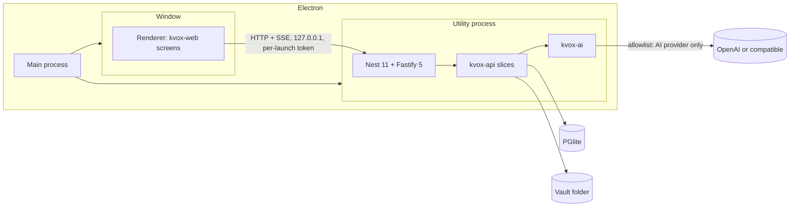

# KVox Desktop

Single-user, offline-first desktop application for meeting notes and a personal knowledge graph.

## What it is

- Inputs: PDF transcripts, KVox transcript export JSON, Markdown or text, and KVox note exports. There is no transcription ([ADR-0006](https://github.com/marinoscar/kvox/blob/main/docs/decisions/0006-desktop-inputs-no-transcription.md)).
- Outputs: AI notes, a connected-knowledge graph, search, and Ask.
- AI: OpenAI or an OpenAI-compatible base URL. GitHub Copilot is an extension ([ADR-0005](https://github.com/marinoscar/kvox/blob/main/docs/decisions/0005-ai-architecture-shared-harness.md)).
- Data stays on the device. The AI provider is the only cloud egress ([ADR-0004](https://github.com/marinoscar/kvox/blob/main/docs/decisions/0004-desktop-data-local-only.md)).

## Core principle

**This repository contains no domain logic.** All domain behaviour lives in the published `@marinoscar/kvox-*` packages ([ADR-0001](https://github.com/marinoscar/kvox/blob/main/docs/decisions/0001-packages-first.md)).

| Belongs here | Belongs in the packages |
|---|---|
| Port bindings (the ten ports of `@marinoscar/kvox-api/ports`, `KvoxWebHost`), the data folder and its backup | Transcripts, notes, search, graph, Ask |
| The shell: navigation, settings hub, theme | Prompts, pipelines, structured-output rules, the tool loop, budgets |
| Packaging and updates | Schemas, parsers, importers |
| Host glue: settings namespaces, onboarding | Task-to-model choice, error mapping (`@marinoscar/kvox-ai`, #579) |

If Desktop needs different behaviour, add an option or a port to the package. Do not fork.

## Architecture



## Tech stack

| Concern | Choice | Source |
|---|---|---|
| Shell | Electron 44.9.0 (pinned exactly; bundles Node 24.22.0) | [ADR-0002](https://github.com/marinoscar/kvox/blob/main/docs/decisions/0002-desktop-shell-electron.md) |
| Build | electron-vite | ADR-0002 |
| Server | Nest 11, Fastify 5, in a `utilityProcess` | ADR-0002 |
| Renderer | React 19, MUI 9, React Router 7 | ADR-0002 |
| Database | PGlite (Postgres in WebAssembly) with vector, pg_trgm, uuid-ossp | [ADR-0003](https://github.com/marinoscar/kvox/blob/main/docs/decisions/0003-graph-store-postgresql-everywhere.md) |
| Packaging | electron-builder, electron-updater | ADR-0002 |
| Tests | Vitest, Playwright for Electron | ADR-0002 |

## Data and privacy

Data folder (`app.getPath('userData')`):

| OS | Folder |
|---|---|
| Windows | `%APPDATA%\KVox` |
| macOS | `~/Library/Application Support/KVox` |
| Linux | `~/.config/KVox` |

Everything KVox keeps lives there, and nowhere else ([ADR-0004](https://github.com/marinoscar/kvox/blob/main/docs/decisions/0004-desktop-data-local-only.md)):

| Path | Holds |
|---|---|
| `db/` | PGlite's data directory: notes, transcripts, the graph, jobs and the app settings (`system_settings`, `user_settings`) |
| `vault/<key>` | The bytes of every document and stored object, one file per object. Files appear whole (written elsewhere, then renamed) |
| `logs/audit.log` | Append-only JSON lines: who, what, which id, counts. Never titles, text or file names |
| `secrets.bin` | Saved API keys, each an Electron `safeStorage` blob (OS keychain, DPAPI or Secret Service) |
| `settings.json` | The shell's own preferences (the plaintext-keys consent below) |
| `tmp/` | Scratch files and upload parts; emptied at every start |

Saved keys never rest in the clear. On Linux without a keyring, Electron falls back to its `basic_text` backend; KVox then refuses to save a key (HTTP 409, `secret_storage_plaintext`) and Settings > Data and privacy shows a warning. Keys are saved only after you set up a keyring or explicitly accept plaintext storage there.

What leaves the device:

- Text sent to the configured AI provider when you generate a note or extract the graph. A `sensitive` PersonFact never leaves.
- A request to GitHub Releases, only if you enable update checks (default off).

No telemetry, no crash upload, no remote fonts. Both processes enforce it:

- **Window**: the page's CSP allows only loopback (`connect-src http://127.0.0.1:*`), and the session cancels any request that is not loopback, `kvox:`, `file:`, `data:`, `blob:` or `devtools:`.
- **Server**: a global undici dispatcher (for `fetch`) and a guard on every outgoing socket (`http`, `https`, `tls`, `net`) allow loopback and the AI provider's host only (`api.openai.com` until D3 wires the configured base URL).

Every blocked request is an error line in the log with the host only (`window: egress blocked: example.com`, `server: egress blocked: example.com`), plus a running count. The loopback server requires a per-launch token. For fully offline use, point the OpenAI-compatible base URL at a local model server (Ollama, LM Studio).

### Export data and Restore

Settings > Data and privacy > **Export data…** writes one `.kvoxbackup` file wherever you choose. It is a zip of:

- `db.tar.gz`: a PGlite dump taken after a checkpoint.
- `vault/`: every document.
- `manifest.json`: the app version, the database's migrations, and each file's size and SHA-256.

**Restore…** checks a backup and replaces everything with it:

- Every file is checked against the manifest.
- Entries that would land outside the data folder are refused.
- A backup from a newer app version is refused.
- The app then restarts its server, which swaps the data in before the database opens. Any failure puts the previous data back.

Both run as background jobs. Saved API keys, `settings.json` and the logs are not in a backup: the keys only decrypt for this OS user on this machine, so enter them again after a restore.

## Importing

Notes > **Import…** opens the system file dialog; dropping files anywhere on the window does the same. KVox reads each file in the main process and sends it to the local server (never anywhere else):

| You import | KVox creates | Then |
|---|---|---|
| A PDF transcript, a Markdown or a text file | A note source document; its text is extracted | "New note" opens with the document chosen: pick a template and generate |
| A transcript exported from KVox web as JSON (`kvox.transcript/v1`) | A transcript, with its speaker names and recording date | "New note" opens with the transcript chosen |
| A note exported from KVox web as Markdown | The same note (same title and body), ready to edit | The note opens |

The file's content decides, not its name (`detectKvoxImport` in `@marinoscar/kvox-contract/notes`); the formats are read by the packages, never here. A file KVox cannot use (audio, video, a foreign JSON) gets the server's own explanation. Size limits are the slices': 5 MiB for a note, 25 MiB for a transcript, `ai.maxDocumentBytes` (10 MiB) for a document. There is no transcription: audio and video are refused.

## AI providers

| Provider | Setup | Status |
|---|---|---|
| OpenAI | Paste the API key in settings; it is stored in the OS keychain | First release |
| OpenAI-compatible | Set the base URL (and key if needed) | First release |
| GitHub Copilot | One more provider adapter (#581) | Later, if its requirements can be met |

## Repository layout

```
src/main/        Electron main process: window, kvox:// scheme, window egress guard, server lifecycle,
                 safeStorage and Notification for the server, backup dialogs, import (dialog, dropped files)
src/preload/     Preload bridge (kvoxDesktop: connection, data folder, backup dialogs, secret storage, import)
src/renderer/    React app: KvoxWebHost over loopback, kvox-web notes screens, settings cards (settings/registry.tsx),
                 the Import action and drop target (import/)
src/server/      Utility process: Nest 11 + Fastify 5 on 127.0.0.1, PGlite, server egress guard
  ports/         One adapter per port (below)
  backup/        .kvoxbackup export and restore, run as jobs
src/shared/      Main <-> server message types
scripts/         prepare-db.mjs (schema, migrations, client), vendor-kvox-packages.mjs
vendor/kvox/     The four @marinoscar/kvox-* tarballs (temporary, see below)
tests/unit/      Vitest: the ports conformance kit, jobs (timeouts, back-off, a real kill mid-job), egress, secrets, backup
tests/crash/     The child process the crash-recovery test kills
tests/unit/import.test.ts  every import kind against the real local server
tests/e2e/       Playwright for Electron (smoke, window egress and settings, import by dialog and drag and drop)
tests/fixtures/  Synthetic import fixtures (a PDF transcript, a transcript JSON, a note export)
```

### Ports

| Port | Adapter (`src/server/ports/`) | Rules |
|---|---|---|
| `KVOX_OBJECT_STORE` | `local-fs-object-store.ts`: `vault/<key>`, rows in `storage_objects` | Atomic writes; `managedBy` in `storage_objects.metadata`; keys with `..`, absolute paths, backslashes or drive prefixes refused; delete removes file and row |
| `KVOX_JOBS` | `pg-table-jobs.ts`: in-process runner over `jobs` | One job at a time; `maxRuntimeMs` enforced (abort signal); exponential back-off; `running` rows recovered at start-up; `KvoxRateLimitError` defers without spending an attempt; dedup via `jobs_active_dedup_uniq_idx` |
| `KVOX_IDENTITY` | `launch-token-identity.ts` | The seeded local user; per-launch bearer token |
| `KVOX_SETTINGS` | `pg-settings.ts`: `system_settings`, `user_settings` | The host declares the system `ai` namespace; `defaults: undefined` reads as `undefined` |
| `KVOX_SECRETS` | `safe-storage-secrets.ts`: `secrets.bin` | `safeStorage` via the main process; refuses `basic_text` without consent |
| `KVOX_NOTIFY` | `desktop-notify.ts`: Electron `Notification` via the main process | Heading and a fixed line; no note content |
| `KVOX_EVENTS` | `KvoxEventEmitterEvents` (package default) | |
| `KVOX_AUDIT` | `jsonl-audit.ts`: `logs/audit.log` | Append-only; ids and counts only |
| `KVOX_PRISMA` | The PGlite-backed client (`database.ts`) | Pool of one |
| `KVOX_BRAND` | `KVox Desktop` | |
| `KVOX_AI` | The package fake | D3 (#584) |

`tests/unit/ports-conformance.test.ts` runs `describeKvoxPortsConformance` against these adapters (all but `ai`).

## Getting started

Prerequisites: Node 24 or later, npm 11 or later.

```bash
npm ci
npm run dev        # prepare the database layer, then run the app with hot reload
npm run typecheck
npm test           # unit tests (Vitest)
npm run build      # prepare:db + electron-vite build (out/)
npm run e2e        # Playwright for Electron against out/ (Linux: xvfb-run -a npm run e2e)
npm run dist       # build + unsigned installers in release/
```

`KVOX_E2E_EXECUTABLE=<path to the packaged app>` makes `npm run e2e` drive an installed or unpacked app instead of `out/` (CI does this).

### How a launch works

1. The main process mints a random per-launch token and forks the server utility process (`out/main/server.js`).
2. The server installs its egress guard, applies a staged restore if there is one, then opens PGlite in-process under `<userData>/db` with `vector`, `pg_trgm` and `uuid_ossp`, creates `vector` and `pg_trgm`, serves it on a loopback socket (one connection), runs `prisma migrate deploy` and, when that applied anything, `kvox-db check --database`. Both run as child processes on the Electron binary (`ELECTRON_RUN_AS_NODE`), with Prisma's update check off.
3. It seeds the one local user, adopts the default organization, seeds the note templates and starts Nest on `127.0.0.1:0`. Every route needs `Authorization: Bearer <token>`. Then it recovers the jobs a previous run left `running` (requeued, or failed when out of attempts) and starts the job loop.
4. The window loads `kvox://app`, asks the preload for the port and token, and mounts the kvox-web notes screens over a `KvoxWebHost` that talks HTTP + SSE to the loopback server.


## Package versions

Pin the `@marinoscar/kvox-*` packages to exact versions and bump them together; they are one release group. `@marinoscar/platform-db` is pinned to `0.1.0-next.5`, the version `@marinoscar/kvox-db` was tested with.

**Temporary: the kvox packages are vendored.** Until marinoscar/kvox#577 publishes them to npm, `vendor/kvox/` holds the four tarballs, built from marinoscar/kvox and packed with `npm pack` (as `examples/bare-host/run.mjs --from pack` does). `vendor/kvox/SOURCE.json` records the kvox commit and each tarball's SHA-256; `package.json` depends on them through `file:` paths. To refresh:

```bash
npm run vendor:kvox                       # clones marinoscar/kvox main, builds, packs
npm run vendor:kvox -- --kvox ../kvox     # or from an existing checkout
npm install                               # then commit vendor/kvox/ and package-lock.json together
```

When the packages are on npm, replace the `file:` specs with exact versions and delete `vendor/` and the script.

## Database migrations

`npm run prepare:db` (run by `dev` and `build`) writes `prisma/` (git-ignored): `platform db sync`, `platform db compose`, `kvox-db sync --names after-host`, compose again, `prisma generate`. The platform installer gets a fixed `--timestamp`, so the same package versions always produce the same migration directory names. Open point (marinoscar/kvox#595): an upgrade that adds a platform migration shifts the `after-host` names of the domain migrations, which an existing user database has already recorded; this needs a decision in the packages before the first release that ships to users.

## Roadmap

| Issue | Step | Scope |
|---|---|---|
| #577 | D0 | Publish the packages |
| #582 | D1 | Stack spike |
| #583 | D2 | Ports and local data |
| #584 | D3 | AI wiring |
| #585 | D4 | Imports |
| #586 | D5 | Graph and Ask |
| #587 | D6 | Packaging |

Package-side work in the kvox repository: #570 (PR #575), #571, #572, #573, #578, #579, #580, #581.

Version 1 acceptance bar: the app answers both reference questions from imported meetings.

1. "What are the action items from Joe?"
2. "What meetings have we had with Jenny's boss?"

## More

- [KVox Desktop guide](https://github.com/marinoscar/kvox/blob/main/docs/guides/kvox-desktop.md)
- [Host ports spec](https://github.com/marinoscar/kvox/blob/main/docs/specs/kvox-ports.md)
- [Packages](https://github.com/marinoscar/kvox/blob/main/docs/PACKAGES.md)
- [Architecture decisions](https://github.com/marinoscar/kvox/blob/main/docs/decisions/README.md)
